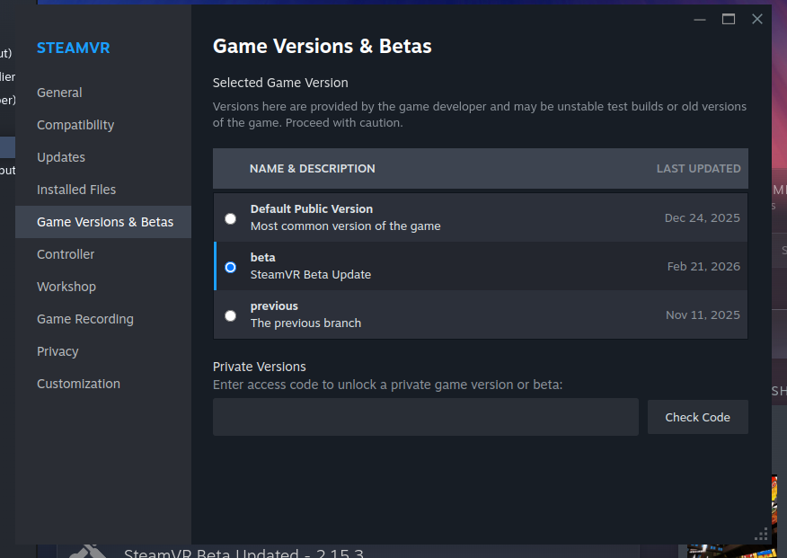

🌐 [English](STEAM-LINK.md) | **Italiano**

# SteamVR su Pico 4 con Steam Link VR (2026)

**Nota veloce (aggiornamento 2026)**  
Valve ora offre **Steam Link VR** per Pico 4 (e altri visori Pico). Permette di **trasmettere i giochi SteamVR dal PC direttamente al visore via Wi-Fi**, con una configurazione minima e senza installare ALVR a mano.

> ⚠️ **Supporto Linux:** per ora sperimentale. Alcuni utenti possono incontrare problemi di driver o di stabilità. Se hai problemi, torna alla [guida originale](../README.it.md) per lo streaming manuale.

---

## Requisiti

- Visore Pico 4 con il firmware più recente;
- Steam installato sul PC, con SteamVR;
- **SteamVR iscritto alla beta pubblica**;
- Accesso al Pico Store per scaricare l'app **Steam Link VR**;
- Connessione Wi-Fi stabile (meglio a 5 GHz).

---

## Avvio rapido

1. **Installa Steam Link VR** sul Pico 4:
   - Apri il **Pico Store**;
   - Cerca **Steam Link VR** e installala.

2. **Prepara il PC**:
   - Assicurati che Steam e SteamVR siano in esecuzione;
   - Attiva **Remote Play** nelle impostazioni di Steam (`Steam > Impostazioni > Remote Play`).

3. **Attiva la beta di SteamVR** *(obbligatorio)*:
   Per la compatibilità con Steam Link VR, iscriviti alla **beta pubblica di SteamVR**:

   1. Apri Steam e vai in **Libreria > Strumenti**
   2. Trova **SteamVR**, clic destro e scegli **Proprietà**
   3. Vai nella scheda **Beta**
   4. Scegli **`public_beta - Public Beta`** dal menu a tendina
   5. Chiudi e riavvia SteamVR

   

4. **Collega il visore**:
   - Avvia **Steam Link VR** sul Pico;
   - Cerca il PC sulla stessa rete;
   - Associalo e avvia lo streaming;

5. **Regola le impostazioni se serve**:
   - Usa l'interfaccia VR per scegliere le opzioni di grafica e prestazioni;
   - Se hai lag o scatti, prova il Wi-Fi a 5 GHz o un collegamento via cavo per il PC;

---

## Risoluzione dei problemi

- **Nessun PC trovato:** verifica che PC e visore siano sulla stessa rete e che Steam sia in esecuzione;
- **Problemi di prestazioni:** abbassa le impostazioni grafiche VR o prova un collegamento via cavo;
- **Problemi specifici di Linux:** Steam Link VR su Linux è ancora sperimentale. Alcune funzioni potrebbero non andare; valuta di ripiegare sulla configurazione manuale con ALVR della [guida originale](../README.it.md)

---

## Riferimenti

- [Steam Link sul Pico Store](https://store-global.picoxr.com/en/detail/1/7494362493653958711)
- [Guida ALVR](../README.it.md)
- [Articolo di GamingOnLinux sul supporto Linux di Steam Link VR](https://www.gamingonlinux.com/2025/09/steam-link-vr-now-available-for-pico-and-htc-headsets-plus-valve-confirm-experimental-linux-support)

---

## Nota finale

Dalla mia esperienza con Steam Link VR sul Pico 4:

- Possono capitare disconnessioni, a volte anche frequenti;
- A volte il visore fatica ad avviare la connessione o l'associazione.

Dal lato positivo:

- La qualità visiva, soprattutto la resa dei colori, è migliore rispetto allo streaming manuale;
- Reattività e latenza in genere sono migliori;
- La facilità d'uso è molto superiore alla configurazione manuale con ALVR.

Con qualche miglioramento futuro, è probabilmente **il modo migliore di usare il Pico 4 su Linux** per la maggior parte degli utenti.
